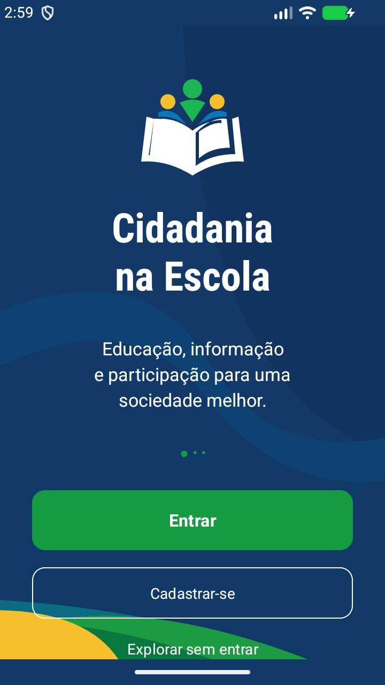
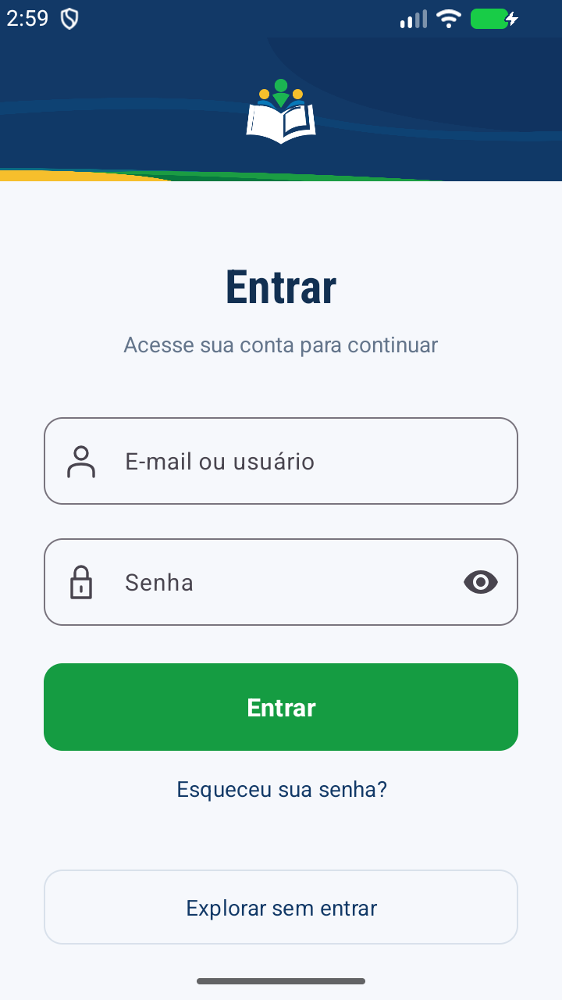
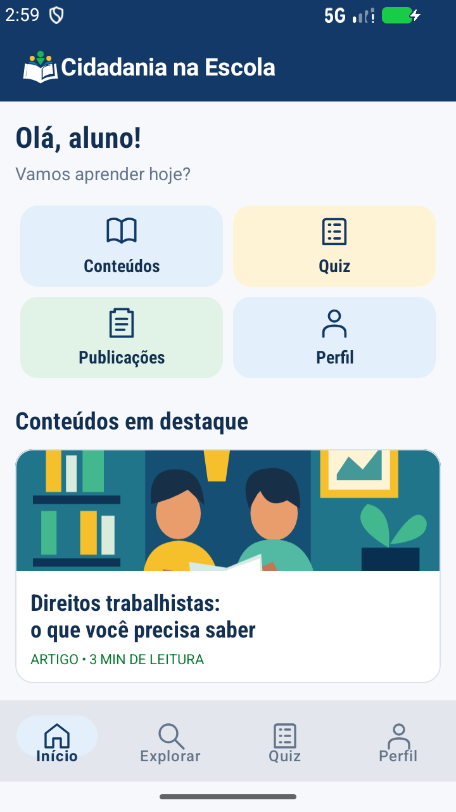
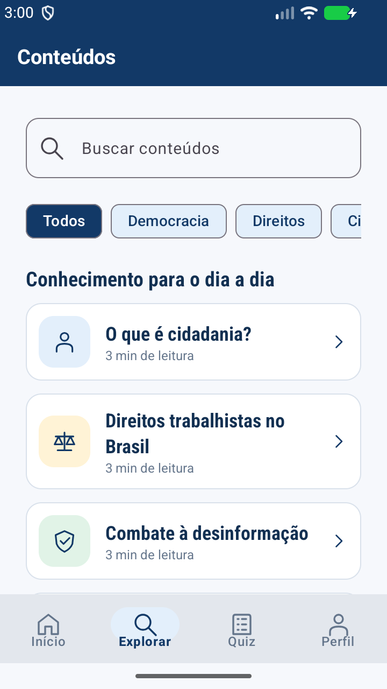
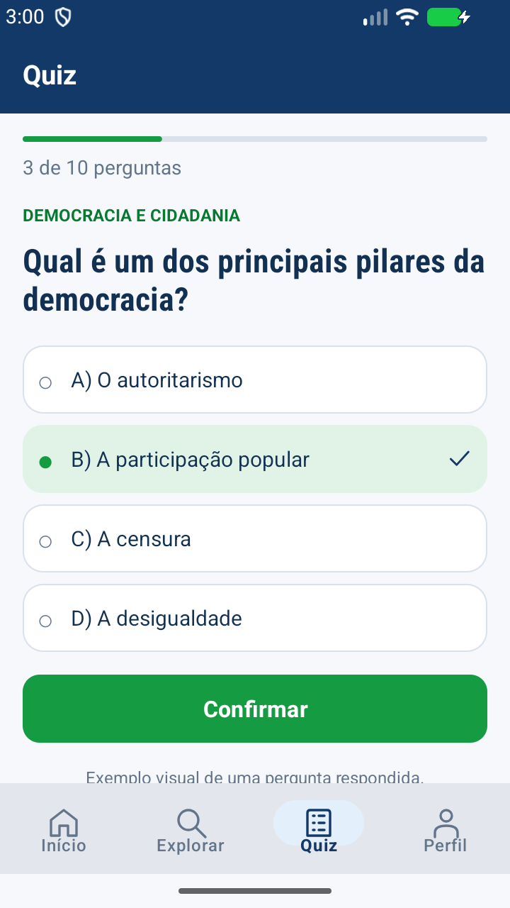
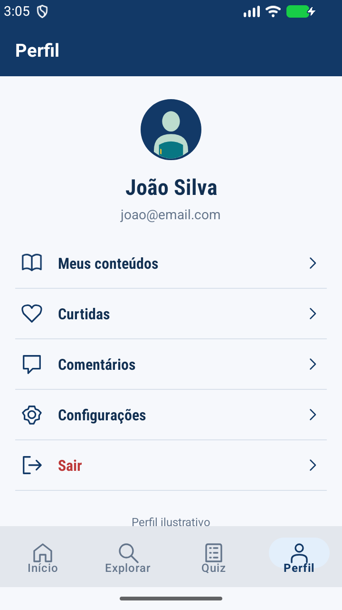

<div align="center">

# 🏛️ Cidadania na Escola — Mobile

### 📱 Informação de qualidade também é conquista.

**Educação • Cidadania • Democracia • Pensamento crítico**

[](https://developer.android.com/)
[](https://www.java.com/)
[](https://developer.android.com/studio)
[](#-status-do-projeto)

**[🌐 Acessar o site](https://marcoslima2207.github.io/Cidadania-na-Escola/)** · **[💻 Repositório web](https://github.com/marcoslima2207/Cidadania-na-Escola)** · **[📱 Repositório mobile](https://github.com/marcoslima2207/Cidadania-na-Escola-MOBILE)**

</div>

---

## ✨ Sobre o projeto

O **Cidadania na Escola Mobile** é um aplicativo Android desenvolvido em **Java e XML**, com o objetivo de aproximar conteúdos educativos do cotidiano de estudantes e da comunidade escolar, incluindo a **Educação de Jovens e Adultos (EJA)**.

A iniciativa faz parte de um projeto de extensão universitária que aborda **cidadania, democracia, direitos trabalhistas, combate à desinformação e participação social**.

> 🎯 **Nossa missão:** tornar o acesso à informação educativa mais simples, acessível e próximo de quem aprende pelo celular.

## 🚦 Status do projeto

**Fase atual: protótipo visual navegável.** As telas e os caminhos de navegação já foram preparados. Os dados exibidos são demonstrativos: **login, cadastro, publicações, quiz dinâmico, API e banco de dados ainda não estão operacionais no aplicativo**.

| Área | Situação |
| :-- | :-- |
| Identidade visual e layouts | ✅ Implementados |
| Navegação com Activity e Fragments | ✅ Implementada |
| Menu inferior e telas complementares | ✅ Implementados |
| Formulários de acesso | 🎨 Apenas interface |
| Conteúdos, comunidade e perfil | 🎨 Dados demonstrativos |
| Quiz | 🎨 Demonstração visual |
| Integração com API Django REST | ⏳ Planejada |
| Persistência via PostgreSQL | ⏳ Planejada no backend |

## 📲 Telas do aplicativo

<div align="center">

| Abertura | Login | Início |
| :--: | :--: | :--: |
|  |  |  |
| **Explorar** | **Quiz** | **Perfil** |
|  |  |  |

</div>

> As imagens acima aparecem quando os arquivos `docs/previews/` estão presentes no repositório.

### 🧭 Experiência de navegação

- **Abertura:** apresentação do projeto e opção de explorar sem login.
- **Início:** atalhos e conteúdos educativos em destaque.
- **Explorar:** categorias, cartões de artigos e campo de busca visual.
- **Quiz:** interface de perguntas e alternativas demonstrativas.
- **Comunidade:** publicações de exemplo e formulário visual.
- **Perfil:** informações ilustrativas, atalhos e configurações.
- **Materiais e Sobre:** recursos educativos e apresentação da iniciativa.

## 🛠️ Tecnologias

| Tecnologia | Papel no projeto |
| :-- | :-- |
| **Java 11** | Lógica de interface e navegação |
| **XML** | Layouts, estilos e recursos visuais |
| **Android Studio** | Desenvolvimento, testes e execução |
| **AndroidX / AppCompat** | Activity, Fragments e compatibilidade |
| **Material Components** | Componentes de interface |
| **Gradle** | Compilação e geração do APK |

**Configuração documentada:** Android mínimo **8.0 (API 26)**, SDK de compilação/alvo **37**, Gradle Wrapper **9.6.0** e **JDK 25** para executar o Gradle.

### 🔗 Arquitetura prevista

```text
                  ┌─────────────────────┐
                  │  Aplicativo Android │
                  │     Java + XML      │
                  └──────────┬──────────┘
                             │ HTTP / JSON
                  ┌──────────▼──────────┐
                  │ Django REST Framework│
                  │    API do projeto   │
                  └──────────┬──────────┘
                             │
                  ┌──────────▼──────────┐
                  │     PostgreSQL      │
                  │   Dados do projeto  │
                  └─────────────────────┘
```

A integração acima **ainda será implementada**. O site utiliza Angular/TypeScript e deverá compartilhar os serviços do backend com o aplicativo.

## 🗂️ Organização do código

```text
app/src/main/
├── java/com/example/cidadania_na_escola/
│   ├── MainActivity.java       # Navegação principal e menu
│   ├── ScreenFragment.java     # Telas e caminhos de navegação
│   └── ContentSamples.java     # Conteúdos demonstrativos
├── res/
│   ├── layout/                 # Telas XML
│   ├── drawable/               # Imagens e vetores
│   ├── menu/                   # Menus
│   ├── color/                  # Cores
│   └── values/                 # Strings, temas e estilos
└── AndroidManifest.xml
```

## ▶️ Como executar

1. Clone o repositório:

   ```bash
   git clone https://github.com/marcoslima2207/Cidadania-na-Escola-MOBILE.git
   ```
2. Abra a pasta clonada no **Android Studio**.
3. Aguarde a sincronização do **Gradle** e configure o **JDK 25** para o Gradle, conforme necessário.
4. Selecione o módulo `app` e um emulador ou dispositivo com **Android 8.0 ou superior**.
5. Clique em **Run ▶**. Na abertura, escolha **Explorar sem entrar** para conhecer as telas.

Para compilar e executar a análise estática no Windows:

```powershell
.\gradlew.bat assembleDebug lintDebug
```

O APK de testes é gerado em `app/build/outputs/apk/debug/app-debug.apk`.

## 🧩 Próximas etapas

- [ ] Integrar a interface à API Django REST Framework.
- [ ] Implementar cadastro, autenticação e recuperação de senha.
- [ ] Carregar conteúdos reais, busca e filtros.
- [ ] Implementar quizzes com perguntas, correção e pontuação.
- [ ] Conectar perfil, publicações, curtidas e comentários.
- [ ] Disponibilizar materiais e envio de mídias conforme o backend.
- [ ] Validar acessibilidade, erros de conexão e testes em dispositivos físicos.
- [ ] Preparar uma versão de distribuição assinada.

### 🌱 Evoluções futuras

Leitura offline, notificações, histórico de aprendizagem, moderação de conteúdo e testes automatizados são possibilidades para etapas posteriores.

## 👥 Equipe

Projeto desenvolvido em grupo como iniciativa acadêmica de extensão universitária.

**Integrantes e orientador(a):** a confirmar na documentação oficial do projeto.

---

<div align="center">

### 💙 Cidadania na Escola

**Informação de qualidade também é conquista.**

*Tecnologia a serviço da educação e da participação cidadã.*

</div>
